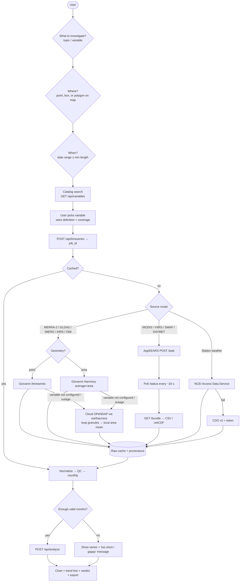
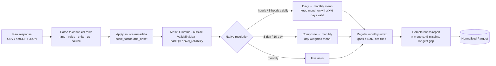
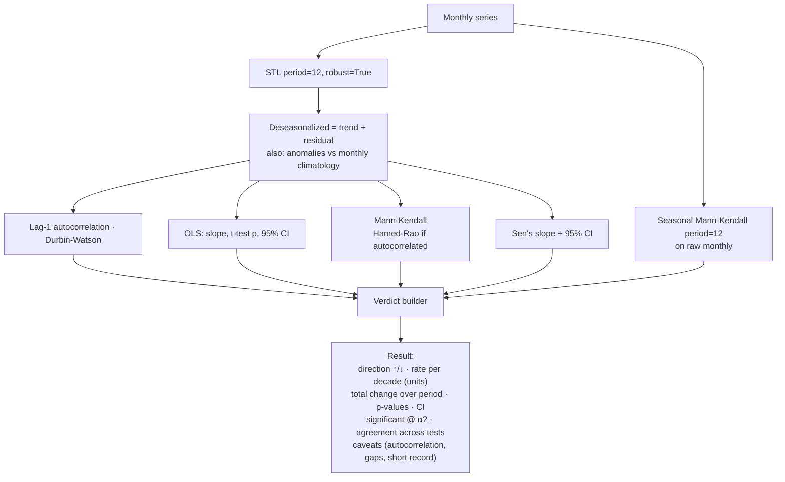
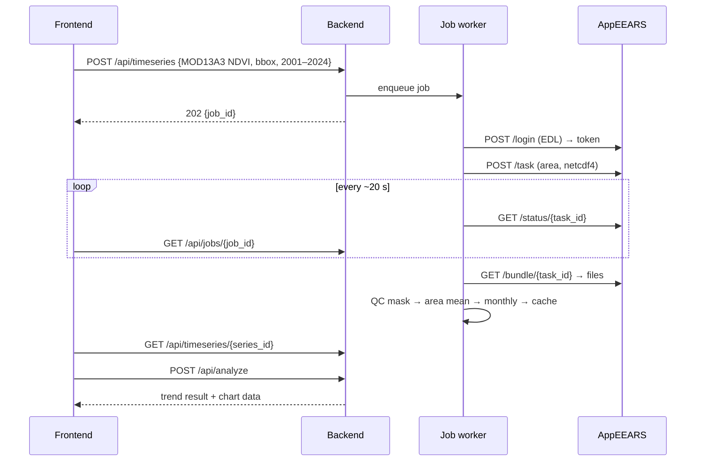

# Architecture — Earth System Trend Detective

Status: **design only, nothing built yet.** Data comes only from the official challenge resources (see [02-platforms-and-apis.md](02-platforms-and-apis.md)).

Proposed stack, to be confirmed by the team:
- Python FastAPI backend (the scientific Python libraries are verified there).
- React + Plotly + Leaflet frontend.
- Parquet/SQLite cache.

---

## 1. System architecture (divisions)

```mermaid
flowchart LR
  subgraph FE["① FRONTEND (React)"]
    W[Question wizard<br/>What? Where? When?]
    VP[Variable picker<br/>+ plain-language definitions]
    MAP[Map: point / bbox / polygon]
    CH[Time-series chart<br/>raw · deseasonalized · trend line]
    RC[Result card<br/>rate, total change, significance]
    DEMO[Guided demos]
  end

  subgraph API["② BACKEND API (FastAPI)"]
    R1[/variables/]
    R2[/timeseries jobs/]
    R3[/analyze/]
    R4[/demos · /sources/status/]
  end

  subgraph CAT["③ CATALOG SERVICE"]
    C1[Curated variable catalog<br/>built from Giovanni configured-variables<br/>+ AppEEARS /product + NCEI datatypes]
    C2[CMR metadata enrichment<br/>long name, units, definition]
    C3[Source router<br/>variable → connector]
  end

  subgraph CONN["④ DATA CONNECTORS (adapters)"]
    G1[Giovanni point<br/>/timeseries]
    G2[Giovanni area<br/>Harmony average=area]
    G3[Cloud OPeNDAP / earthaccess<br/>fallback]
    A1[AppEEARS<br/>task → poll → bundle]
    N1[NCEI Access Data Service]
    N2[CDO v2 fallback]
  end

  subgraph TS["⑤ TIME-SERIES ENGINE"]
    P1[Parse + provenance]
    P2[QC: fill / scale / valid range / quality flags]
    P3[Aggregate to monthly<br/>+ completeness check]
  end

  subgraph AN["⑥ ANALYSIS ENGINE"]
    S1[STL deseasonalize]
    S2[OLS slope + t-test + 95% CI]
    S3[Mann-Kendall Hamed-Rao<br/>+ Seasonal MK]
    S4[Sen's slope + CI]
    S5[Diagnostics + plain-language verdict]
  end

  subgraph ST["⑦ STORAGE / CACHE"]
    K1[(Raw response cache<br/>keyed by request hash)]
    K2[(Normalized series Parquet)]
    K3[(Job table + results)]
  end

  subgraph SEC["⑧ AUTH / OPS"]
    E1[EDL bearer token + .netrc]
    E2[NOAA CDO token]
    E3[Retry/backoff 429 · quota watch · GES DISC alerts]
  end

  FE --> API
  R1 --> CAT
  R2 --> C3 --> CONN
  CONN --> K1 --> TS --> K2
  R3 --> AN
  K2 --> AN --> K3 --> API
  SEC -.-> CONN
  C2 -.CMR.-> C1
```



### Division responsibilities

| # | Division | Owns | Key rule |
|---|---|---|---|
| ① | Frontend | Wizard, map, charts, result card, demos, glossary | Never calls NASA/NOAA directly; it calls our API only |
| ② | Backend API | REST contract, validation, job orchestration | Stateless; long fetches run as **jobs** |
| ③ | Catalog | Which variables exist, their definitions, which connector serves each | Catalog entries come only from the official listing endpoints; no hand-typed data |
| ④ | Connectors | One adapter per official API, sharing a common interface `fetch(variable, geometry, start, end) → RawSeries` | Each adapter records full provenance (URL, dataset, version, time of access) |
| ⑤ | Time-series engine | Parse → QC → monthly series | Masks fill and invalid values using the **source's own metadata** |
| ⑥ | Analysis | Trend tests and verdict | Deterministic; versioned method parameters |
| ⑦ | Storage | Cache and results | Same request means a cache hit, which avoids quota burn |
| ⑧ | Auth/Ops | Secrets, rate limits, outage notices | Tokens live in the server env only |

---

## 2. API endpoints (our backend)

| Method | Path | Body / params | Returns |
|---|---|---|---|
| GET | `/api/variables` | `q`, `domain` (land/atmosphere/ocean/hydrology), `region_type` | List of `{id, name, definition, units, source, temporal_res, coverage_start/end, spatial_mode: point/area}` |
| GET | `/api/variables/{id}` | — | Full metadata + CMR link + DOI |
| POST | `/api/timeseries` | `{variable_id, geometry: Point or BBox or Polygon (GeoJSON), start, end}` | `{job_id}` (202) |
| GET | `/api/jobs/{job_id}` | — | `{status: queued, fetching, processing, done or error, progress, source_status}` |
| GET | `/api/timeseries/{series_id}` | `view=raw or monthly or deseasonalized` | `{time[], value[], units, n_valid, completeness, provenance}` |
| POST | `/api/analyze` | `{series_id, alpha=0.05, deseasonalize=true, methods:[ols,mk,seasonal_mk,sen]}` | Trend results (see §5) |
| POST | `/api/compare` | `{series_ids[]}` (same variable, different regions) | Per-region results + FDR-adjusted p |
| GET | `/api/demos` | — | Pre-built demo cases (cached real data) |
| GET | `/api/sources/status` | — | Giovanni quota, GES DISC alerts, upstream health |
| GET | `/api/export/{series_id}` | `format=csv or json` | Data + provenance + citation |

---

## 3. End-to-end flow (user → result)



### Source routing table

| Variable family | Point | Area | Fallback |
|---|---|---|---|
| Air temp, humidity, pressure (MERRA-2) | Giovanni `/timeseries` | Giovanni Harmony area-average | Cloud OPeNDAP M2TMNXSLV monthly |
| Soil moisture, runoff, ET, snow (GLDAS) | Giovanni | Giovanni Harmony | OPeNDAP GLDAS_NOAH025_M |
| Precipitation (GPM IMERG) | Giovanni `GPM_3IMERGDF/M_07` | Giovanni Harmony | OPeNDAP GPM_3IMERGM |
| Atmos. temp / water vapour / OLR (AIRS) | Giovanni AIRS3STD | Giovanni Harmony | OPeNDAP AIRS3STM |
| NO₂, ozone, aerosol index (OMI) | Giovanni OMNO2d / OMTO3d | Giovanni Harmony | OPeNDAP |
| NDVI, LST, ET, GPP, snow, burned area (MODIS) | AppEEARS point task | AppEEARS area task → local mean | — |
| Soil moisture 2015+ (SMAP) | AppEEARS | AppEEARS | — |
| Station temp / precip | NCEI ADS | nearest stations in bbox (CDO `/stations`) | CDO v2 `/data` |

---

## 4. How the time series works (engine ⑤)



**Canonical record:** `{series_id, time (month start, UTC), value, units, n_obs, qc_pass_ratio}`.

**Provenance block:** `{source_api, dataset_short_name, version, concept_id or product_id, variable, geometry, request_url, retrieved_at, doi}`.

Design choices (team to confirm; not prescribed by the challenge):
- Analysis runs on a **monthly** series. The challenge says daily and monthly data are easiest.
- Minimum valid days per month (X) defaults to 70%.
- Minimum record length for testing defaults to **10 years, 120 months**, the same length as the SeaWiFS paper's record. Shorter series are still plotted with a "too short" warning.
- Missing data is never interpolated. We do not invent values.

---

## 5. Analysis engine (⑥)



Result JSON contract:
```json
{
  "series_id": "…",
  "period": {"start": "2001-01", "end": "2024-12", "n_months": 288, "missing_pct": 2.1},
  "deseasonalized": true,
  "ols":  {"slope_per_decade": 0.31, "ci95": [0.18, 0.44], "p": 0.0004, "r2": 0.07},
  "mann_kendall": {"variant": "hamed_rao", "tau": 0.21, "z": 3.4, "p": 0.0007, "trend": "increasing"},
  "seasonal_mk": {"p": 0.001, "trend": "increasing"},
  "sen": {"slope_per_decade": 0.29, "ci95": [0.16, 0.42]},
  "diagnostics": {"lag1_autocorr": 0.34, "durbin_watson": 1.3},
  "verdict": {"significant": true, "alpha": 0.05, "tests_agree": true,
              "plain_language": "Rising about 0.3 °C per decade; very unlikely to be random chance (p < 0.001)."},
  "provenance": {}
}
```
(The numbers above are placeholders that show the shape only.)

---

## 6. Sequence: async fetch (AppEEARS example)



---

## 7. Proposed repo layout (not created yet)

```
NASA/
├─ docs/                    # this design + research
├─ frontend/                # ① React app
│  └─ src/{wizard,map,charts,results,demos,glossary}/
├─ backend/
│  ├─ api/                  # ② FastAPI routers
│  ├─ catalog/              # ③ catalog builder + router + definitions
│  ├─ connectors/           # ④ giovanni.py, harmony.py, opendap.py,
│  │                        #    appeears.py, ncei.py, cdo.py, base.py
│  ├─ timeseries/           # ⑤ parse, qc, resample, completeness
│  ├─ analysis/             # ⑥ stl, ols, mannkendall, sen, verdict
│  ├─ storage/              # ⑦ cache, parquet, jobs
│  └─ core/                 # ⑧ config, auth, retry, alerts
├─ scripts/build_catalog.py # pulls official variable lists → catalog.json
└─ tests/                   # recorded real responses as fixtures
```

## 8. Team split (example for 4–5 people)

| Person | Divisions |
|---|---|
| A | ④ Giovanni / Harmony / OPeNDAP connectors + ⑧ auth |
| B | ④ AppEEARS + NCEI connectors |
| C | ⑤ Time-series engine + ⑥ Analysis engine |
| D | ① Frontend (wizard, map, charts) |
| E | ③ Catalog + definitions + demos + pitch |

## 9. Known risks (from verification)

| Risk | Mitigation |
|---|---|
| Giovanni quota size is unknown | Cache aggressively; check `/quota`; pre-compute the demos |
| Giovanni variable outages (current GES DISC alert) | Read `/api/sources/status`; fall back to OPeNDAP |
| AppEEARS jobs take about 15 min | Async jobs + progress UI; demos served from cache |
| Cloud OPeNDAP fetches one granule per request (slow) | Use monthly collections (M2TMNX*, GLDAS_M, IMERGM) only |
| Land-model variables masked over ocean | Validate geometry against the variable's domain |
| KNMI / CSA have no usable time-series API | Show as reference links only; not in the pipeline |
