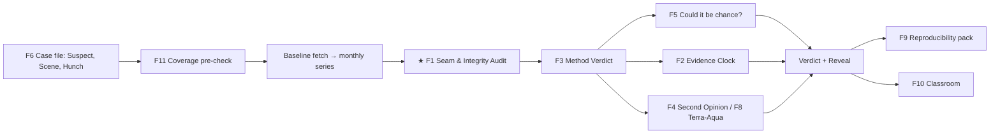

# Trend Detective: Feature Specification

**Signature feature:** F1 Seam & Integrity Audit.

This document lists every feature in one place. For each one it gives the problem it solves, the solution, and how it plugs into the baseline in [03-architecture.md](03-architecture.md). Evidence links come from [painpoints/](painpoints/) and the novelty research in [novelty/](novelty/).

**Data rule:** all data comes only from the official challenge APIs (Giovanni, AppEEARS, NOAA NCEI, CMR, Cloud OPeNDAP). Nothing is invented or interpolated, and every number comes from division ⑥.

**Architecture divisions** (referred to by number throughout):

| # | Division | # | Division |
|---|---|---|---|
| ① | Frontend | ⑤ | Time-series engine |
| ② | Backend API | ⑥ | Analysis engine |
| ③ | Catalog | ⑦ | Storage/cache |
| ④ | Connectors | ⑧ | Auth/Ops |

---

## 0. Pitch

> **Trend Detective checks four things before it calls a trend "significant":** that the data is intact, that the test fits the data, that the time window wasn't cherry-picked, and that a second NASA product agrees. Every feature runs only on official NASA and NOAA data.

## 1. Feature map

| Tier | ID | Feature | One-line promise |
|---|---|---|---|
| ★ Signature | **F1** | Seam & Integrity Audit | "Before we call it a trend, we check it isn't a broken record or a satellite swap." |
| Core | **F2** | Evidence Clock + cherry-pick rank | "Is it real yet? If not, when will we know?" |
| Core | **F3** | Method Verdict (Trend Court) | "We pick the right test, show where tests disagree, and say why." |
| Core | **F4** | Second Opinion | "Does another NASA product, or the nearest station, agree?" |
| Core UX | **F5** | Could It Be Chance? (lineup + null histogram) | "See for yourself whether the trend could be random." |
| Core UX | **F6** | Detective Case File (predict, then reveal) | "Make your hunch, then let NASA data judge it." |
| Extended | **F7** | FDR Trend Map | "Which parts of your region are *really* changing?" |
| Extended | **F8** | Terra vs Aqua Instrument Check | "Is this trend in the Earth, or in the satellite?" |
| Extended | **F9** | Reproducibility Pack | "Re-run this exact analysis yourself." |
| Extended | **F10** | Be the Skeptic (classroom mode) | "Students test claims about their own place." |
| Extended | **F11** | Smart Coverage Pre-check | "Never get an empty or wrong-dataset result." |
| Optional | **F12** | Trend Scan (what's changing here?) | "Draw a box and we find which variables are trending." |
| Optional | **F13** | Ask the Catalog | "Ask in plain English and get the right NASA variables." |
| Optional | **F14** | Evidence Chain | "Rain ↓ → soil ↓ → vegetation ↓: see the links." |
| Optional | **F15** | Heat Island Twin | "Is your city warming faster than its countryside?" |
| Optional | **F16** | Region Fingerprint | "What kind of land is this, and what should we look at?" |

**Build order:** Baseline → F1 → F3 → F2 → F5 → F4 → F6 → Extended → Optional.

---

## ★ F1: Seam & Integrity Audit (signature)

### Problem
| What goes wrong | Evidence |
|---|---|
| NASA's Cloud Giovanni inserted **spurious blocks of zeros** into 10 GLDAS, MERRA-2, NLDAS and GRACE collections (data before 2024). It was found Nov 2025 and fixed 2026-03-26, with no guidance for data already downloaded. | [NASA alert](https://www.earthdata.nasa.gov/data/alerts-outages/reprocessed-hydrology-products-available-from-cloud-giovanni) (official) |
| A satellite handover changes trend reliability. IMERG trends agree with gauges 86.7% of the time in the GPM era, but only 75.3% in the TRMM era. | Zhu et al. 2024/25, ERL, [doi:10.1088/1748-9326/ad984e](https://doi.org/10.1088/1748-9326/ad984e) |
| Changes to the reanalysis observing system (SSM/I in 1987, AMSU in 1998) create unphysical precipitation trends. | Gelaro et al. 2017, J. Climate, [doi:10.1175/JCLI-D-16-0758.1](https://doi.org/10.1175/JCLI-D-16-0758.1) |
| MODIS Terra orbital drift after 2020 biases products. | [NTRS 20240001409](https://ntrs.nasa.gov/citations/20240001409); [doi:10.1016/j.srs.2023.100116](https://doi.org/10.1016/j.srs.2023.100116) |
| "Data is all fill values"; mm/month units are biased by month length. | Giovanni user guide (official) |
| "How do I find where an abrupt change happens?" (10.4k views) | [stats.SE/116363](https://stats.stackexchange.com/questions/116363) |

### Solution
- **Fit-for-trends badge** (✅ OK / ⚠️ Caution / ❌ Not fit) with reasons listed.
- **Coverage strip:** % of valid pixels for each month. Months below the threshold are greyed out and excluded from the fit.
- **Integrity flags:** runs of exact zeros or constant values are highlighted. Data retrieved before a NASA fix date is also flagged.
- **Seam markers:** vertical lines at known instrument and version changes. Each one is cited, for example IMERG TRMM→GPM (2014-06), Terra drift (2020-02), Terra exit (2022-10), MERRA-2 (1987/1998), GLDAS 2.0→2.1.
- **Step tests:**
  - Step-dummy OLS at each known seam.
  - Pettitt test for unknown breaks.
  - Trend shown **before vs after** each break.
- **Days-in-month normalisation** for monthly-rate units.
- **Wording:** always "possible instrument effect", never "artifact".

### Integration
| Division | Change |
|---|---|
| ③ Catalog | `catalog/events.json`: `{dataset, date, type, description, citation_url}`. This is the only hand-curated file, and every entry is sourced. |
| ⑤ Time-series | `timeseries/integrity.py`: `zero_runs()`, `constant_runs()`, `coverage_per_step()`, `normalize_days_in_month()` |
| ⑥ Analysis | `analysis/seams.py`: `step_test(series, dates)`, `pettitt(series)`, `segment_trends(series, breaks)` |
| ⑧ Ops | `core/alerts.py`: compares `provenance.retrieved_at` against NASA alert fix dates |
| ② API | `GET /api/timeseries/{series_id}/integrity` returns `{badge, reasons[], coverage[], flags[], seams[{date, source, step_p, trend_before, trend_after}], pettitt{date, p}}` |
| ① Frontend | Seam lines plus segment trend lines on the chart, a coverage strip under it, and the badge on the result card |
| Data | Uses the baseline series only. No new API calls. Collection versions come from CMR. |

**Judge wow:** The IMERG rainfall chart splits at June 2014 and shows a trend on each side. A recorded series with a zero block (labelled *simulated*) is caught: "NASA's own pipeline shipped this bug — we detect it."

**Limits:**
- A step can be a real climate shift.
- The event list is incomplete.
- Short segments have low statistical power.

---

## F2: Evidence Clock + Cherry-Pick Rank

### Problem
| What goes wrong | Evidence |
|---|---|
| Hunting for "pause" or "acceleration" windows is hidden multiple testing. | Rahmstorf, Foster & Cahill 2017, ERL, [doi:10.1088/1748-9326/aa6825](https://doi.org/10.1088/1748-9326/aa6825) |
| Short cherry-picked windows mislead the public. | [Skeptical Science "Escalator"](https://skepticalscience.com/escalator_2022.html) |
| Choosing a window by its slope breaks the significance test. | PIK release (naturefund.de) |
| "How do I test over many start/end values?" | [stats.SE/12988](https://stats.stackexchange.com/questions/12988), [/419351](https://stats.stackexchange.com/questions/419351) |
| The challenge itself: "all a trend needs to become significant is a longer period". | Challenge page |

### Solution
- **Trend triangle:** a heatmap of slope and significance for every start × end year (windows of 10+ years). It is labelled *exploratory*.
- **End-year slider:** grows the record and recalculates the confidence interval live.
- **Years-to-detect** (Weatherhead 1998): *"If the current rate and noise persist, about 7 more years (≈2031)."* It shows "can't tell" when the slope is near 0.
- **Cherry-pick rank:** *"Your 10-year window ranks 3rd of 34 same-length windows. It's unusually flat."*

### Integration
| Division | Change |
|---|---|
| ⑥ Analysis | `analysis/detectability.py`: `trend_triangle()` (about 300 windows, Sen + Hamed-Rao MK), `expanding_window()`, `years_to_detect(sigma_n, phi, omega)`, `window_rank()` |
| ② API | `GET /api/analyze/{series_id}/detectability` returns `{triangle[], expanding[], years_to_detect, window_rank, assumptions}` |
| ⑦ Storage | Cache the triangle for each series |
| ① Frontend | Plotly heatmap, slider, countdown card |

**Judge wow:** Drag the end year and the cells turn significant. Rainfall: "Not yet: ≈2031."

**Limits:**
- Assumes AR(1) noise and that the current trend persists.
- The cells overlap, so they are not independent tests.

---

## F3: Method Verdict (Trend Court)

### Problem
| What goes wrong | Evidence |
|---|---|
| The choice of prewhitening changes Mann-Kendall (MK) p-values and Sen slopes; plain MK gives false positives. | Collaud Coen et al. 2020, AMT, [doi:10.5194/amt-13-6945-2020](https://doi.org/10.5194/amt-13-6945-2020) |
| "Which trend test should I use?" (20.3k views) | [stats.SE/512049](https://stats.stackexchange.com/questions/512049) |
| "Why is prewhitening important?" (19.4k views) | [stats.SE/221072](https://stats.stackexchange.com/questions/221072) |
| MK significant but Sen slope = 0 | [stats.SE/557979](https://stats.stackexchange.com/questions/557979) |
| When to use Seasonal Kendall (0 answers) | [stats.SE/138138](https://stats.stackexchange.com/questions/138138) |
| Giovanni's regression line "does not draw a scientific trend conclusion" | Giovanni user guide (official) |

### Solution
- **Diagnostics first:** a lag-1 autocorrelation badge and a seasonality test (Kruskal-Wallis by month). These **choose the test automatically and explain why**.
- **Jurors side by side:** OLS + t-test, raw MK, TFPW-prewhitened MK, Hamed-Rao MK, Seasonal MK, Sen's slope.
- **"Conclusion flips" flag** when the jurors disagree.
- **Consistency checker:** explains ties and zero slopes.
- **Cross-examination toggles:** seasonal cycle left in, shorter record.
- **Stamp:** SIGNIFICANT / NOT PROVEN, with a plain-language sentence.

### Integration
| Division | Change |
|---|---|
| ⑥ Analysis | `analysis/robustness.py`: wraps `pymannkendall` (`original_test`, `trend_free_pre_whitening_modification_test`, `hamed_rao_modification_test`, `seasonal_test`), `scipy.stats.kruskal`, `theilslopes`, a ties check, and `choose_test()` |
| ② API | `POST /api/analyze` adds `court{jurors[], chosen_test, reason, flips, stamp}` and `verdict.explain[]` |
| ① Frontend | Juror table, stamp, toggles |

**Judge wow:** Switch off the autocorrelation correction and the stamp flips: "This is how papers overclaim."

**Limits:** Agreement between tests is not proof of a trend.

---

## F4: Second Opinion (cross-product / cross-region agreement)

### Problem
| What goes wrong | Evidence |
|---|---|
| "How to test if two series' trends are the same" (**235k views**) | [stats.SE/19103](https://stats.stackexchange.com/questions/19103) |
| Conflicting sea-ice trends from different sources | [earthscience.SE/884](https://earthscience.stackexchange.com/questions/884) |
| 22 precipitation products disagree; reanalyses split into "wet" and "dry" camps | Alexander, Contractor et al. 2020, ERL, [doi:10.1088/1748-9326/ab79e2](https://doi.org/10.1088/1748-9326/ab79e2) |
| Reanalysis differs from stations by more than 25% | r/meteorology/comments/es9r40 (search snippet only) |

### Solution
- **Same region, second source:** IMERG vs MERRA-2 precipitation, or MERRA-2 T2M vs the nearest NCEI station. Shows each slope plus a trend test on the **difference series**.
- **Two regions, same variable:** a slope-difference z-test using the effective sample size.
- **Badge:** ROBUST (signs and significance agree) or DISPUTED.

### Integration
| Division | Change |
|---|---|
| ③ Catalog | `quantity_groups.json`: which variables measure the same quantity, plus independence tags |
| ④ Connectors | Reuses Giovanni and NCEI. Nearest station via CDO `/stations` |
| ⑥ Analysis | `analysis/compare.py`: `difference_trend()`, `slope_diff_test(n_eff)` |
| ② API | `POST /api/compare` with `mode=slope_diff\|product_agreement` |
| ① Frontend | Overlay chart plus agreement badge |

**Judge wow:** Temperature shows ROBUST across satellite, model and station. Rainfall shows DISPUTED.

**Limits:**
- A station point doesn't fully represent a grid cell.
- When units differ, only the sign of the trend is compared.

---

## F5: Could It Be Chance? (lineup + null histogram)

### Problem
| What goes wrong | Evidence |
|---|---|
| Students "didn't really understand the P-value" | [mathmedic.com AP Stats blog](https://mathmedic.com/blog/the-holy-grail-of-ap-statistics-the-p-value/) |
| Visual lineups work as a valid inference method | Buja et al. 2009; Majumder et al. 2013 (**verify**) |
| Simulation-based inference improves conceptual understanding | Tintle et al. 2011/12 (**verify**) |

### Solution
- **Lineup:** the real series hidden among 19 block-bootstrap shuffles (12-month blocks). The user tries to spot the real one.
- **Null histogram:** the real slope dropped onto 1,000 shuffled slopes, giving a "permutation p" next to the MK p.
- Labelled *"simulated from your data, not observations."* Block shuffling keeps the autocorrelation, so the result is not overstated.

### Integration
| Division | Change |
|---|---|
| ⑥ Analysis | `analysis/permutation.py`: `block_bootstrap(series, block=12, n=1000, seed)` |
| ② API | `POST /api/analyze/nulls` `{series_id, n_panels:19, n_null:1000}` returns `{panels[], real_index, null_slopes[], perm_p}` |
| ⑦ Storage | Cache the nulls for each series |
| ① Frontend | Lineup grid plus animated histogram |

**Limits:** Missing the real series in the lineup does not mean there is no trend.

---

## F6: Detective Case File (predict, then reveal)

### Problem
| What goes wrong | Evidence |
|---|---|
| People judge local change from memory ("I don't trust my memory") | [tildes.net thread](https://tildes.net/~enviro/pl9/has_your_local_climate_gotten_noticeably_warmer_in_your_lifetime) |
| Skeptical students engage when they collect the data themselves | [lpm.org 2019](https://www.lpm.org/news/2019-09-28/how-to-teach-climate-change-to-skeptical-students-have-them-collect-their-own-data) |
| Predicting before a demonstration improves learning | Crouch et al. 2004 (**verify**) |
| The challenge asks for "data detectives" plus guided demos | Challenge page |

### Solution
- A case-file flow: **Suspect** (variable) → **Scene** (region) → **Hunch** (the user draws the expected line, or taps ↑ / → / ↓) → **Evidence** (the real series drawn over the hunch) → **Verdict** (F1 + F3 + F2).
- Two cached demo cases: one significant, one "not yet".
- Variable definitions come from CMR metadata.

### Integration
| Division | Change |
|---|---|
| ① Frontend | Case-file layout, draw layer, a keyboard alternative, and a score for how far the hunch was from the data |
| ③ Catalog | `demos.json` (demo case metadata); "suspect cards" built from CMR long names and units |
| ⑦ Storage | Precomputed demo series and results |

---

## F7: FDR Trend Map (extended)

**Problem:**
- Testing every grid cell separately overstates change. After correcting for multiple tests, the area of significant greening falls from 35.2% to 15.3%: Cortés et al. 2021, GRL, [doi:10.1029/2020GL091496](https://doi.org/10.1029/2020GL091496).
- Wilks 2016, BAMS, explains why stippled significance maps mislead.
- Users don't know how to summarise per-pixel results: [gis.SE/475383](https://gis.stackexchange.com/questions/475383).

**Solution:**
- A per-cell Sen slope and MK test.
- A toggle between raw p<0.05 and Benjamini-Hochberg false-discovery-rate (FDR) correction (α_FDR = 2α).
- A readout of "% of area significant before vs after".
- Highlighting of sub-regions where the trend has the opposite sign.

**Integration:**
- ④ `opendap.py` bbox-cube fetch of the monthly collections (GPM_3IMERGM, GLDAS_NOAH025_M, M2TMNXSLV).
- ⑤ xarray cube.
- ⑥ `analysis/fieldsig.py` (vectorised MK + `multipletests('fdr_bh')`).
- ② `POST /api/trendmap`.
- ① Leaflet raster with stippling.
- Pre-cache 2 regions, capped at about 40×40 cells.

---

## F8: Terra vs Aqua Instrument Check (extended)

**Problem:**
- Sensor drift and switching between sensors create spurious NDVI trends: Jeong et al. 2024, RSE, [doi:10.1016/j.rse.2024.114282](https://doi.org/10.1016/j.rse.2024.114282) (snippet only).
- Terra orbital drift: Twedt 2023, NTRS.

**Solution:** Run the same variable from Terra (MOD) and Aqua (MYD). If the two trends diverge, label the result "possibly instrument-driven". The comparison feeds into F1's badge.

**Integration:**
- ④ A second AppEEARS task (e.g. MOD13A3.061 + MYD13A3.061).
- ⑥ `compare.difference_trend()` (shared with F4).
- ① Adds a row to the F1 panel.

---

## F9: Reproducibility Pack (extended)

**Problem:**
- Remote-sensing results are hard to reproduce: Kedron & Frazier 2022, [doi:10.3390/rs14215471](https://doi.org/10.3390/rs14215471).
- The NASA zero-block alert gave no way to audit data downloaded earlier.
- Paid software is a barrier (XLSTAT costs about $1k; r/statistics, snippet only).

**Solution:** A one-click export containing:
- `data.csv`
- `provenance.json`: dataset short name, version, DOI, concept ID, region, dates, request URL, `retrieved_at`.
- `integrity_log.json`: the F1 results.
- `analysis.py`: a script that reproduces the result with pymannkendall and statsmodels.

**Integration:**
- ⑦ Provenance is already stored.
- ② `GET /api/export/{series_id}?format=bundle`.
- ⑥ `export/script_template.py`.

---

## F10: Be the Skeptic, classroom mode (extended)

**Problem:**
- 82% of teachers have faced skepticism from students (NSTA poll, 2011): [ncse.ngo](https://ncse.ngo/nsta-poll-climate-change-education).
- 55% don't teach climate change, and 17% lack materials (NPR/Ipsos 2019): [kut.org](https://www.kut.org/2019-04-22/most-teachers-dont-teach-climate-change-4-in-5-parents-wish-they-did).
- Classroom use of NASA data is "tricky", with problems around devices and skills: [My NASA Data poster, SERC](https://serc.carleton.edu/earth_rendezvous/2018/program/posters/wednesday/202413.html).

**Solution:**
- The teacher shares a case code.
- Students state a hypothesis, then test it on their own place using F6.
- The class's hunches are shown as an anonymous histogram.
- No login is needed, it works on Chromebooks, and there is a printable lesson card plus CSV export.

**Integration:**
- ② `POST /api/class` and `POST /api/class/{code}/vote`.
- ⑦ A vote-counts table.
- ① Classroom view.

---

## F11: Smart Coverage Pre-check (extended)

**Problem:**
- Searches silently return nothing because the data sits in a sibling collection (GRACE vs GRACE-FO), which one user called "just baffling": [earthaccess #1434](https://github.com/earthaccess-dev/earthaccess/issues/1434).
- Land-model variables are masked over the ocean (GES DISC alert).

**Solution:** Before fetching, check the request against the collection's CMR temporal and spatial extent and its land/ocean domain. Warn the user and suggest a sibling collection where one exists.

**Integration:**
- ③ `catalog/router.py` gets `precheck()`, which calls CMR `/collections.json` and uses a `siblings` map.
- ② `POST /api/timeseries` returns `warnings[]` before the job is queued.

---

## F12: Trend Scan (optional)

**Problem:** The baseline answers "is X trending here?" Users want "what is changing here?", but testing many variables invites p-hacking.

**Solution:**
- Draw a box. The tool tests about 12 monthly catalog variables suited to that region.
- Benjamini-Hochberg correction is applied across the variables.
- A ranked leaderboard shows *all* results: "12 tested, 3 significant after FDR".

**Integration:**
- ② `POST /api/scan` (batch jobs).
- ⑥ Reuses the FDR code from F7.
- ① Leaderboard with sparklines.
- Giovanni Harmony area averaging. **Risk:** the quota is unknown, so pre-run the demos.

---

## F13: Ask the Catalog (optional)

**Problem:**
- Users are overwhelmed by the number of datasets (r/gis, snippet only).
- Giovanni is "not very intuitive" (r/civilengineering, snippet only).

**Solution:**
- A plain-English question (e.g. "Is Delhi's air getting dirtier?") returns ranked variables with reasons and a related NASA paper.
- **Guardrails:**
  - The LLM can only choose from a closed list of catalog IDs; anything else is rejected.
  - The reasons it gives must quote CMR or GCMD text.
  - Papers are rendered from NTRS API fields.
  - The LLM never sees or emits data values.

**Integration:**
- ③ Embeddings index plus GCMD KMS synonyms (`cmr.earthdata.nasa.gov/kms`).
- NTRS API (`ntrs.nasa.gov/api/citations/search`).
- ② `GET /api/suggest?q=`.
- ① Free-text first step in the wizard.

---

## F14: Evidence Chain (optional)

**Problem:** The challenge asks teams to relate trends to the processes behind them. Separate per-variable trends don't show a mechanism.

**Solution:**
- A curated chain, e.g. precipitation ↓ → soil moisture ↓ → NDVI ↓ → LST ↑.
- Each link gets its own trend verdict.
- Arrows are labelled with the lagged correlation, using detrended anomalies and an effective-degrees-of-freedom p-value.
- The wording is always "consistent with", never "caused by".

**Integration:**
- ③ `chains.json`.
- ⑥ `analysis/relate.py`.
- ② `POST /api/relate`.
- ① Chain diagram.
- Data: GPM_3IMERGM (Giovanni), GLDAS_NOAH025_M (OPeNDAP), MOD13A3 / MOD11A2 (AppEEARS).
- **Risk:** AppEEARS latency, and the GLDAS v2.1 Giovanni ID is unverified.

---

## F15: Heat Island Twin (optional)

**Problem:** "Is my city getting hotter?" Regional climate noise hides the land-use signal.

**Solution:**
- Draw a city polygon; a rural ring is generated around it automatically.
- Trend of urban minus rural LST, day and night, plus the NDVI difference.

**Integration:**
- ① Polygon plus buffer.
- ④ Two AppEEARS area tasks (MOD11A2, MOD13A3).
- ⑤ Difference series.
- ⑥ Unchanged.
- **Risk:** the ring may include water or other towns.

---

## F16: Region Fingerprint (optional)

**Problem:** The challenge suggests recommending variables by region type (desert, rainforest, estuary, city).

**Solution:**
- Read MODIS land cover (MCD12Q1.061) for the box, e.g. "62% evergreen broadleaf, 8% urban".
- A versioned rule table maps land-cover class → GCMD keyword → catalog variables.
- This feeds into F12 and F13.

**Integration:**
- ④ AppEEARS land-cover task.
- ③ `rules/landcover_to_variables.json`.
- ① Pie chart in the wizard.

---

## 2. Integration summary

### New modules
| Division | Files |
|---|---|
| ③ Catalog | `events.json` (F1), `quantity_groups.json` (F4), `demos.json` (F6), `router.precheck()` (F11), `chains.json` (F14), `rules/landcover_to_variables.json` (F16), embeddings index (F13) |
| ④ Connectors | `opendap.py` bbox cube (F7), MOD + MYD tasks (F8), AppEEARS land cover (F16) |
| ⑤ Time-series | `integrity.py` (F1) |
| ⑥ Analysis | `seams.py` (F1), `detectability.py` (F2), `robustness.py` (F3), `compare.py` (F4, F8), `permutation.py` (F5), `fieldsig.py` (F7, F12), `relate.py` (F14), export script template (F9) |
| ⑦ Storage | Caches for triangle / nulls / demos, class votes (F10) |
| ⑧ Ops | `alerts.py` fix-date check (F1) |

### New / extended endpoints
| Method | Path | Feature |
|---|---|---|
| GET | `/api/timeseries/{id}/integrity` | F1 |
| GET | `/api/analyze/{id}/detectability` | F2 |
| POST | `/api/analyze` (adds `court{}`, `verdict.explain[]`) | F3 |
| POST | `/api/compare?mode=slope_diff\|product_agreement` | F4, F8 |
| POST | `/api/analyze/nulls` | F5 |
| POST | `/api/trendmap` | F7 |
| GET | `/api/export/{id}?format=bundle` | F9 |
| POST | `/api/class`, `/api/class/{code}/vote` | F10 |
| POST | `/api/timeseries` (adds `warnings[]`) | F11 |
| POST | `/api/scan` | F12 |
| GET | `/api/suggest?q=` | F13 |
| POST | `/api/relate` | F14 |

### End-to-end flow with features

### Team split (5 people)
| Person | Features |
|---|---|
| A | F1 (`integrity.py`, `seams.py`, `events.json`, endpoint) |
| B | F3 + F5 (`robustness.py`, `permutation.py`, endpoints) |
| C | F2 + F4 (`detectability.py`, `compare.py`, endpoints) |
| D | ① Frontend: F1 markers and badge, F3 court, F2 clock, F5 lineup, F6 case file |
| E | Demo caching, F9 export, project page, video, citation checks. Then extended and optional features if time allows. |

## 3. Verify before pitching
- Weatherhead 1998: the 3.3 constant, the 2/3 exponent, and the definition of σN.
- Zhu 2024/25 and Jeong 2024: only abstract snippets were seen.
- Buja, Majumder, Tintle, Crouch: cited from memory by the agents.
- All Reddit and Earthdata Forum items: search snippets only.
- The submission deadline on the official page.
