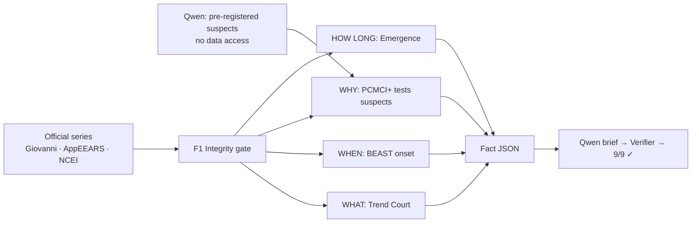

> ✅ **LOCKED as signature novelty on 2026-11-14.** Backup: F1 Seam & Integrity Audit.

# Trend Forensics: When · Why · How Long
### Research-backed signature novelty for Trend Detective

This document sets the signature novelty. Earlier novelty picks are now background: F1 Seam & Integrity Audit (the agreed **backup**) and the [06 feature spec](06-feature-spec.md).

**Evidence**
- Four literature agents searched Google Scholar, Springer, Elsevier, arXiv, AGU/EGU and PyPI/GitHub. Their reports are in [literature/](literature/).
- A judge agent scored 13 candidate methods.
- Every citation below was confirmed by DOI or arXiv ID. Anything not fully verified is marked **[verify]** or **[snippet]**.

**Data rule:** only the official challenge APIs are used: Giovanni, AppEEARS, NOAA NCEI, CMR and Cloud OPeNDAP. GISTEMP is not used.

---

## 1. The idea in one paragraph
Most tools stop at "here is a trend line" (Giovanni's own guide says its line *"does not draw a scientific trend conclusion"*). Trend Forensics answers four questions for any region:
- **WHAT** is changing, and is it significant?
- **WHEN** did the change start, and how sure are we?
- **WHY**: which Earth-system processes are linked to it?
- **HOW LONG**: has the change emerged from natural noise yet, and if not, when will it?

Qwen has a strict role. **It only proposes hypotheses and narrates. Deterministic, peer-reviewed methods run on official NASA data decide every number.**

## 2. Why a generic LLM (even Qwen 5.4) can't do this
| Reason | Evidence |
|---|---|
| LLMs reason about raw time series only marginally above chance, and up to 30 points below humans | Merrill et al., Findings of EMNLP 2024, arXiv:2404.11757 |
| LLM causal chains are mostly associative pattern-matching, not causal reasoning | arXiv:2510.13417 (2025) |
| Using an LLM as the statistical test oracle gives highly variable results | Cohrs et al. 2024, arXiv:2406.07378 |
| LLMs are much more reliable at *verifying* explanations against data than at *generating* them | arXiv:2604.02118 (2026, **under review**) |
| An LLM has no access to official data and no provenance | — |
| BEAST posteriors and PCMCI+ conditional-independence tests are computations, not reasoning | Zhao 2019; Runge 2019 |
| No published tool combines LLM hypotheses with PCMCI on NASA Earth-observation data *(to our knowledge)* | literature scan, L2 |

Giovanni and AppEEARS extract data. Neither offers change-point probabilities or multi-variable driver testing.

## 3. Scoring (judge agent, 1–5 per criterion; Risk 5 = low risk)

**Column key:**
- **Res**: research backing
- **Nov**: novelty
- **Stu / Sci / Eng**: value to students, scientists, engineers
- **Chal**: fit to the challenge
- **48h**: buildable in 48 hours
- **Risk**: 5 = low risk

| Method | Res | Nov | Stu | Sci | Eng | Chal | 48h | Risk | Total /40 |
|---|---|---|---|---|---|---|---|---|---|
| **BEAST** (when) | 5 | 4 | 4 | 5 | 3 | 5 | 5 | 4 | **35** |
| **Time of Emergence / years-to-detect** | 5 | 4 | 5 | 4 | 4 | 5 | 5 | 3 | **35** |
| **PCMCI+** (why) | 5 | 4 | 3 | 5 | 2 | 5 | 3 | 3 | **30** |
| Verified Trend Brief | 4 | 4 | 5 | 3 | 3 | 4 | 4 | 3 | 30 |
| Segmented regression | 4 | 2 | 3 | 4 | 3 | 4 | 5 | 5 | 30 |
| ETCCDI extremes scorecard | 5 | 3 | 3 | 4 | 4 | 4 | 4 | 3 | 30 |
| **Qwen hypothesis → PCMCI+** | 3 | **5** | 4 | 4 | 2 | 5 | 3 | 2 | 28 |
| Nonstationary GEV design-storm drift | 5 | 4 | 2 | 4 | 5 | 3 | 3 | 2 | 28 |
| Dominance / SHAP | 3 | 2 | 3 | 3 | 3 | 4 | 5 | 4 | 27 |
| SPI/SPEI drought | 5 | 2 | 3 | 3 | 4 | 3 | 4 | 3 | 27 |
| Wet-bulb heat days | 4 | 3 | 4 | 3 | 4 | 3 | 3 | 2 | 26 |
| Chronos forecast / anomaly | 3 | 3 | 4 | 2 | 3 | 2 | 4 | 2 | 23 |
| Satellite IDF curves | 3 | 3 | 1 | 3 | 5 | 2 | 2 | 2 | 21 |

---

## 4. The product: four panels, one story

| Panel | Question | Decided by | Qwen's role |
|---|---|---|---|
| **WHAT** | Is it changing, how much, is it significant? | Baseline + F3 Trend Court (Hamed-Rao MK, Sen, OLS) | none |
| **WHEN** | When did it start, and how sure are we? | **BEAST** Bayesian ensemble | narrates |
| **WHY** | Which processes are linked to it? | **PCMCI+** (Tigramite) | **proposes suspects before seeing data** |
| **HOW LONG** | Has it emerged from the noise? When will we know? | **Time of Emergence** + years-to-detect | narrates |
| *(gate)* | Is the data fit for trend analysis? | **F1 Seam & Integrity Audit** (backup novelty) | none |

### Qwen guard-rail protocol
1. **Pre-registration.** Qwen receives only the region, the target variable and a variable bundle, and no data. It returns `suspects[{driver_id, target_id, sign, lag_months, mechanism}]`. The IDs must come from a closed catalog list, and any other ID is rejected.
2. **Code decides.** PCMCI+ runs unconstrained on the official anomaly series. Each suspect is stamped **CONFIRMED**, **NOT SUPPORTED**, or **UNEXPECTED** (a link Qwen didn't predict).
3. **Verified narration.** Qwen writes `claims[{text, fact_ref}]` from the fact JSON only. A deterministic verifier then:
   - checks every number, date and sign against the facts;
   - blocks causal wording such as "causes";
   - shows a **"claims verified 9/9"** badge.

---

## 5. Method specifications

### 5.1 WHEN: BEAST change-onset detector
| Item | Detail |
|---|---|
| Problem | A single p-value hides *when* a change began and how certain we are. Mann-Kendall misses abrupt shifts, which BEAST caught in Di Nunno 2024. |
| Citations | Zhao et al. 2019, *RSE* 232:111181, doi:10.1016/j.rse.2019.04.034; Di Nunno et al. 2024, *J. Hydrol. Reg. Stud.* 52:101717, doi:10.1016/j.ejrh.2024.101717 |
| Library | `pip install rbeast` (v0.1.25, MIT) |
| Call | `rb.beast(y, start=2001, deltat=1/12, period=1.0)` |
| Input | Monthly target series, e.g. MOD13A3.061 NDVI (AppEEARS), GPM_3IMERGM, GLDAS_NOAH025_M, MERRA-2 T2M |
| Output JSON | `onset{cp, cpPr, cpCI, cpOccPr[], slpSgnPosPr[], ncpPr[], seasonal_cp[], near_seam}` |
| Cross-check | `piecewise-regression` (MIT, doi:10.21105/joss.03859) gives the break date ± CI. A badge appears when the two methods agree. |
| Architecture | ⑥ `analysis/onset.py` · ② `POST /api/onset` · ① change-point probability ribbon under the chart, shaded credible interval, F1 seam lines |
| Demo | A probability peak "2015-03 ± 8 mo (87%)". If it sits next to a cited seam (e.g. IMERG TRMM→GPM 2014-06), it is labelled *possible instrument effect*. |
| Limits | The result depends on prior settings. A change point is not a cause. How missing months are handled must be tested. |

### 5.2 WHY: Suspect Lineup (Qwen hypotheses → PCMCI+)
| Item | Detail |
|---|---|
| Problem | The challenge asks teams to relate trends to the processes behind them. Naive lagged correlation overstates links when variables have memory (McGraw & Barnes 2018, doi:10.1175/JCLI-D-17-0334.1). |
| Citations | Runge et al. 2019, *Sci. Adv.* 5:eaau4996, doi:10.1126/sciadv.aau4996; Runge 2020, arXiv:2003.03685 (PCMCI+); Runge et al. 2023, *Nat. Rev. Earth Environ.* 4:487, doi:10.1038/s43017-023-00431-y; Krich et al. 2020, *Biogeosciences* 17:1033, doi:10.5194/bg-17-1033-2020 |
| Library | `pip install tigramite` (5.2.10.1, **GPL-3.0**, so the backend repo must be open source), Python ≥3.10 |
| Call | `PCMCI(dataframe=pp.DataFrame(X, var_names=names), cond_ind_test=ParCorr()).run_pcmciplus(tau_min=0, tau_max=3)`, then FDR correction (`fdr_bh`) |
| Input | Area-mean **anomalies** (STL-deseasonalized, detrended), about 300 months. Variable bundles are below. |
| Output JSON | `links[{src, tgt, lag, partial_r, p_fdr, n, status, robust_halves}]` plus `suspects[]` with their status |
| Architecture | ⑥ `analysis/drivers.py`; `analysis/llm/hypothesis.py` (no data access) · ② `POST /api/suspects`, `POST /api/interrogate` · ① suspect cards and a link graph with a **naive correlation vs PCMCI** toggle |
| Demo | Qwen's "soil moisture → NDVI, lag 1" is **CONFIRMED**. Its "T2M → NDVI" is **NOT SUPPORTED**. In the naive view the graph fills with spurious arrows. |
| Limits | Assumes no hidden confounders. Explains monthly anomalies, not the long-term trend. Can't see CO₂ fertilization (Zhu et al. 2016, doi:10.1038/nclimate3004), land use or irrigation. Always says "consistent with", never "causes". |

**Default variable bundles (official data only)**
| Story | Variables |
|---|---|
| Vegetation | GPM_3IMERGM precipitation, GLDAS_NOAH025_M SoilMoi0_10cm, MERRA-2 T2M, MOD13A3 NDVI |
| Heat | MERRA-2 T2M, MOD11A2 LST, GLDAS soil moisture, MOD16A2GF ET |
| Air quality | OMI NO₂ / aerosol index, MERRA-2 T2M, MERRA-2 humidity |

### 5.3 HOW LONG: Emergence gauge + years-to-detect
| Item | Detail |
|---|---|
| Problem | A non-significant trend could mean "no change" or "record too short". Students can't tell which. The challenge says a longer record may make a trend significant. |
| Citations | Hawkins & Sutton 2012, *GRL* 39:L01702, doi:10.1029/2011GL050087; Hawkins et al. 2020, *GRL* 47:e2019GL086259, doi:10.1029/2019GL086259; Weatherhead et al. 1998, *JGR* 103(D14):17149, doi:10.1029/98JD00995 **[verify the formula constants]** |
| Library | NumPy, about 20 lines |
| Method | S/N = fitted signal ÷ residual σ. Labels: >1 unusual, >2 unfamiliar, >3 unknown. Years-to-detect: n* = [3.3σN/\|ω\|·√((1+φ)/(1−φ))]^(2/3). Covariate is time, or optionally MERRA-2 global-mean T2M. |
| Output JSON | `emergence{sn, label, emerged_year, years_to_detect, record_years, assumptions}` |
| Architecture | ⑥ `analysis/emergence.py` · ② `GET /api/analyze/{id}/emergence` · ① S/N gauge plus countdown |
| Demo | "Summer temperature here is **UNFAMILIAR** (S/N 2.3), emerged ≈2010". Or: "Rainfall: not yet emerged; ≈N more years of record needed". |
| Limits | Assumes AR(1) noise and that the trend persists. Wording stays conditional. |

### 5.4 Verified Trend Brief (Qwen narration checker)
| Item | Detail |
|---|---|
| Citations | Merrill et al. 2024, arXiv:2404.11757; arXiv:2604.02118 **[under review]**. Prior work: ClimSight, Kuznetsov et al. 2025, *npj Climate Action* 4:97, doi:10.1038/s44168-025-00300-y, which has no per-claim verification. |
| Method | Constrained JSON prompt producing `claims[{text, fact_ref}]`. `verify(claims, facts)` checks numbers, dates and signs, and blocks causal verbs. |
| Output | `brief{claims[{text, fact_ref, verified}], score}` |
| Architecture | ⑥ `analysis/llm/brief.py`, `analysis/llm/verifier.py` · ② `POST /api/brief` · ① a ✓ next to each sentence; hovering shows the source number |
| Demo | "9/9 claims verified". A deliberately wrong number is blocked live. |
| Limits | It verifies faithfulness to the computed facts, not the scientific truth of those facts. |

---

## 6. How it fits the existing features
| Feature | Status |
|---|---|
| **F1 Seam & Integrity Audit** | **Backup novelty.** Acts as a gate before analysis and overlays seams on BEAST change points. |
| F3 Trend Court | Becomes the WHAT panel |
| F2 Evidence Clock | Merged into HOW LONG (years-to-detect) |
| F6 Case File | UX wrapper. Students add their own suspect next to Qwen's. |
| F14 Evidence Chain | Replaced by PCMCI+ Suspect Lineup |
| F9 export, F11 pre-check | Kept (cheap) |
| F4, F5, F7, F8, F10, F12, F13 (except its closed-ID rule), F15, F16 | Dropped / backlog |
| Nonstationary GEV design-storm drift | Engineer stretch goal (Wright et al. 2019, *GRL*, doi:10.1029/2019GL083235) |
| Chronos, IDF, wet-bulb, SPI/SPEI | Dropped (weak fit to the challenge or too costly) |

## 7. New modules and endpoints
| Division | Addition |
|---|---|
| ⑥ Analysis | `onset.py`, `drivers.py`, `emergence.py`, `llm/hypothesis.py`, `llm/brief.py`, `llm/verifier.py` (plus F1 `seams.py`) |
| ② API | `POST /api/onset` · `POST /api/suspects` · `POST /api/interrogate` · `GET /api/analyze/{id}/emergence` · `POST /api/brief` |
| ③ Catalog | `bundles.json` (driver bundles), closed ID list for Qwen, `events.json` (F1) |
| ① Frontend | Change-point ribbon, suspect lineup and graph toggle, emergence gauge, verified brief |
| Dependencies | `rbeast` (MIT), `tigramite` (GPL-3.0), `piecewise-regression` (MIT), `pymannkendall`, `statsmodels`, `scipy` |

## 8. 30-second demo
| Time | Beat |
|---|---|
| 0–5 s | Student picks "vegetation" and draws a box. Qwen lists three suspects **before any data loads**. |
| 5–12 s | NDVI loads, F1 badge ✅, F3 stamp SIGNIFICANT |
| 12–18 s | BEAST ribbon peaks at [year] ± CI, next to an F1 seam line if one applies |
| 18–25 s | Suspect Lineup: 2 CONFIRMED, 1 NOT SUPPORTED. Toggling to naive correlation floods the graph with arrows. |
| 25–30 s | Emergence gauge "UNFAMILIAR" or "not yet: ≈N yrs" · brief "claims verified 9/9" |

Values shown as [placeholders] get filled in once the demo series are cached.

## 9. Pitch
> LLMs reason about time series barely above chance (Merrill 2024), and their causal stories are mostly pattern-matching. So in Trend Forensics, Qwen only *guesses*, and NASA data *decides*. A Bayesian ensemble (BEAST; Zhao 2019) dates when a change began, with a probability. PCMCI+ (Runge 2019, *Science Advances*) tests Qwen's suspects against official MERRA-2, GLDAS, IMERG and MODIS anomalies while controlling for each variable's memory. Hawkins' time-of-emergence method (2020) tells you whether the change has left the range of normal, or how many years until we'll know. Every sentence Qwen writes is verified against the computed numbers. To our knowledge, no published tool combines LLM hypotheses with PCMCI on NASA data.

## 10. Team plan (5 people)
| Person | 0–12 h | 12–30 h | 30–48 h |
|---|---|---|---|
| A, data (④⑧) | Giovanni/Harmony area means, OPeNDAP GLDAS_M | AppEEARS MOD13A3; cache 2 demo bundles | F9 export, backup data |
| B, core stats (⑤⑥) | QC, monthly series, STL, baseline | F3 court; F1 integrity/seams/events.json | Seam ↔ change-point overlay |
| C, WHEN / HOW LONG | rbeast wrapper | Segmented-regression cross-check; emergence module | Weatherhead check, tests |
| D, WHY + Qwen | Qwen prompts and closed-ID schema | PCMCI+ with FDR, half-record robustness, link status | Verifier, brief, adversarial test |
| E, frontend (①) | Case-file shell, chart | Ribbon, lineup cards, gauge | Brief UI, video, pitch |

**24-hour cut**
- One region and one bundle, fully cached.
- Baseline MK, Sen and OLS.
- BEAST ribbon plus F1 seam lines.
- Qwen suspects → PCMCI+ (`tau_max=2`) with a numbers-only verifier.
- Years-to-detect as a single line.
- **Fallback:** if PCMCI slips, ship **F1 + BEAST** as the signature.

## 11. Verify before pitching
- Weatherhead 1998 formula constants (3.3, the 2/3 exponent, σN).
- arXiv:2604.02118 is under review, so cite it as a preprint.
- How BEAST handles missing months.
- Tigramite's GPL-3.0 licence means the repo must be open source.
- Snippet-only items, which are not used in the core: Liu 2023 SHAP percentages, Li 2022, Vecellio, Kong, and the Chronos hydrology evidence.
- The submission deadline on the official page.
