# Trend Detective: Verification, BEAST and Research Evidence

This document covers how the backend decides whether a trend is real, explains it, and backs it with published research. Everything described here is implemented and tested on the `research-evidence` branch.

---

## 1. Pipeline at a glance

```mermaid
flowchart LR
  Q[User question or region scan] --> I[Intent router<br/>what · when · why · how long · compare · forecast]
  I --> D[Official data<br/>Giovanni · AppEEARS · NCEI · USGS · ERDDAP · NSIDC · SWOT]
  D --> A[Stage A: detect<br/>recent window vs before]
  A --> B[Stage B: independent checks<br/>integrity · court · chance · stability · physics · second opinion · FDR]
  B --> C[Stage C: calibrated BEAST gate<br/>direction must agree, change dated]
  C --> L[Label<br/>VERIFIED · PROBABLE · NOT VERIFIED]
  L --> R[Research Evidence<br/>arXiv · OpenAlex · Crossref · NASA NTRS<br/>+ optional Semantic Scholar · Springer · ADS]
  R --> S[Best trend<br/>0.6 data + 0.2 size + 0.2 research]
  S --> V[AI text verifier<br/>numbers · direction · significance · no causal words]
  V --> U[User]
```



Rule: **the AI proposes and narrates; deterministic, published methods decide every number.**

---

## 2. WHEN: calibrated BEAST change dating

File `backend/insights/onset.py`, endpoint `GET /api/analyze/{series_id}/onset`.

BEAST (Zhao et al. 2019, *Remote Sensing of Environment* 232:111181, doi:10.1016/j.rse.2019.04.034) averages thousands of piecewise trend models. It returns, for every month, the probability that the trend changed there.

### Problem found and fixed

BEAST assumes month-to-month noise is independent. Monthly climate anomalies are persistent, so raw BEAST invents change points. Three safeguards fix this:

1. **Memory-matched blocks.** Seasonal anomalies are averaged over L = ceil((1+φ)/(1−φ)) months, where φ is the lag-1 autocorrelation.
2. **Window probability.** The probability of a change is summed over a ±1-year window.
3. **Surrogate calibration.** The identical BEAST procedure is re-run on 49 simulated series with the same trend, memory, noise and missing months, but no change. The p-value comes from that null distribution.

### Calibration results

From `scripts/onset_calibration.py`: 25 trials, 288 months, with a true jump and slope change at month 144.

| φ | Raw BEAST false alarms | Calibrated false alarms | Real breaks detected |
|---|---|---|---|
| 0.0 | 0/25 | 0/25 | 24/25 |
| 0.5 | 25/25 | **0/25** | 19/25 |
| 0.7 | 25/25 | **1/25** | 6/25 |
| 0.8 | 25/25 | **0/25** | 2/25 |

### Output

- **Events:** date, 90% interval, probability, calibrated p-value, type (acceleration / slowdown / reversal), rate before and after.
- **Seam flag:** "possible instrument effect" when a change is within 18 months of a cited data seam.
- **Other fields:** current rising/falling probability and a monthly probability ribbon for charts.
- **Confirmation rule:** only the strongest change can be "confirmed", because the surrogates calibrate only that change.
- **Cost:** about 2 s per series. Results are cached.

---

## 3. WHY: pre-registered suspects + PCMCI+

File `backend/insights/causal.py`; hypotheses in `backend/catalog/data/driver_bundles.json`.

1. **Suspects are fixed before any data is fetched.** They come from textbook hypotheses plus the local AI, which may only choose catalog IDs.
2. **PCMCI+ tests each suspect.** It uses Runge et al. 2019, *Sci. Adv.* 5:eaau4996, and Runge 2020 (UAI), via `tigramite` with ParCorr, on detrended seasonal anomalies. Benjamini-Hochberg FDR is applied across all links.
3. **Each suspect is stamped** supported / opposite_sign / not_supported / unstable / direction_unknown.
   - A link must hold in **both halves** of the record; otherwise it is marked unstable.
   - A same-month link that PCMCI+ cannot orient is marked direction_unknown.
4. **Wording is always associative:** "consistent with", never "caused by".

In the synthetic test, PCMCI+ found the true soil-moisture → vegetation link at a 1-month lag. It rejected an unrelated temperature series, and the half-record check caught a spurious indirect link.

Endpoints:

- `POST /api/ai/suspects`
- `POST /api/drivers` with `method: "pcmci"` and an optional `suspects` list

---

## 4. Verified answers for any question

File `backend/ai/verify.py`. Questions are split into intents: what, when, why, how_long, compare and forecast. `POST /api/investigate` returns `answer.sections`, one direct answer per intent.

Every sentence written by the local AI must pass these checks:

| Check | Rule |
|---|---|
| numbers | every number and year must be traceable to the computed facts |
| direction | rising/falling wording must match the computed direction |
| significance | "significant" claims must match the tests |
| causation | no "caused", "because of", "driven by" or "proves" |
| forecast wording | future values must be called a statistical extrapolation |

If the text fails, the AI gets one rewrite with the reasons. If it fails again, the deterministic text is shown instead.

---

## 5. Active trends (verified "what is changing now")

Files `backend/active/engine.py` and `runner.py`. Endpoint `POST /api/active-trends`, with live events streamed via SSE.

| Stage | What happens |
|---|---|
| **A. Detect** | The recent window (10–15 years) is compared with the years before it, using AR(1)-corrected Mann-Kendall and AR(1)-adjusted OLS |
| **B. Verify** | Independent checks: integrity, trend court, chance test, window stability, physics coherence, second opinion, FDR across variables |
| **C. BEAST gate** | Calibrated BEAST must agree on the current direction and dates when the current behaviour began |
| **Label** | **VERIFIED**: no check failed, at least 3 passed, BEAST agrees and the change is not at a data seam.<br>**PROBABLE**: no check failed, but BEAST is uncertain or there is a warning.<br>**NOT VERIFIED**: anything else. |

The 28 criteria are in `backend/catalog/data/criteria.json`.

---

## 6. Research Evidence: is the trend backed by published studies?

Files `backend/research/literature.py` and `backend/research/evidence.py`.

### Sources (official APIs only)

| Source | Key | Default | Coverage |
|---|---|---|---|
| arXiv API | no | on | preprints |
| OpenAlex | no | on | about 250M works; retracted works excluded |
| Crossref | no | on | every DOI-registered article |
| NASA NTRS | no | on | NASA technical reports |
| Semantic Scholar | `SEMANTIC_SCHOLAR_API_KEY` | only with key | about 200M papers |
| Springer Nature | `SPRINGER_API_KEY` | only with key | Springer journals |
| NASA ADS | `ADS_API_TOKEN` | only with key | NASA science literature |

Google Scholar is not used: it has no API and does not allow automated access. OpenAlex, Crossref and Semantic Scholar index the same journal literature through official APIs. Each source has a 25 s cap and every response is cached. A failing source is reported in `sources` and never stops a scan.

### Algorithm

1. **Query:** variable terms plus region plus "trend", limited to the last 10 years.
2. **Relevance:** the variable named in the title or abstract, the region named, trend language and recency, multiplied by a **trust** weight.

   | Paper type | Trust weight |
   |---|---|
   | Peer-reviewed journal | 1.0 |
   | NASA technical report | 0.85 |
   | Other publication | 0.75 |
   | Preprint | 0.6 |

3. **Reading:** a lexicon reads each abstract's stance. Only sentences that name the variable count.
4. **AI-slop guard:** the local AI may read the top 5 abstracts. Its reading is kept only if its evidence quote appears **verbatim** in the abstract and itself describes the claimed direction. Otherwise it is rejected and counted in `ai_readings.rejected_as_unsupported`.
5. **Agreement:** weighted support versus conflict gives one of four labels:
   - **supported**: support ≥ 2 × conflict
   - **conflicts**: conflict ≥ 2 × support
   - **mixed**: anything in between
   - **no_literature**: no relevant studies found

   The plain-language summary cites DOIs.
6. **Best trend:** score = 0.6 × data verdict + 0.2 × size of change + 0.2 × research agreement.
   - Data verdict: VERIFIED = 1, PROBABLE = 0.6.
   - Research agreement: supported = 1, mixed = 0.5, none = 0.3, conflicts = 0.
   - **NOT VERIFIED trends are never chosen**, whatever the literature says.

### Live check (2026-11-14)

Query: vegetation greenness (NDVI), Sahel, rising.

| Source | Papers returned |
|---|---|
| OpenAlex | 15 |
| Crossref | 15 |
| NASA NTRS | 1 |
| arXiv | 0 |

12 papers were relevant: 4 agree and 1 disagrees, so the label is **supported**. Examples:

- doi:10.1088/1748-9326/ae628c (2026)
- doi:10.1111/aje.70191 (2026)
- doi:10.1088/2515-7620/ae7ceb (2026)

Endpoints:

- `best_trend` and a per-trend `research` block in `POST /api/active-trends`
- `POST /api/research/evidence {variable_id, region_name, direction}`

---

## 7. Configuration

```
RESEARCH_ENABLED=true
RESEARCH_MAX_AGE_YEARS=10
SPRINGER_API_KEY=             # optional
SEMANTIC_SCHOLAR_API_KEY=     # optional
ADS_API_TOKEN=                # optional
```

New dependencies:

- `Rbeast` (MIT)
- `tigramite` (GPL-3.0, so the repository must stay open source)
- `joblib`

## 8. Tests

159 tests pass. New test files:

- `tests/test_forensics.py`
- `tests/test_research.py`
- assertions added to `tests/test_active.py`

One test is known to fail on macOS only: `tests/test_deep_llm.py::test_probe_parses_nvidia_smi`. Its `subprocess.run` mock returns a string, and another caller then calls `.decode()` on it. This is a bug in the test, not in the product.

## 9. Limits

- **Change points:** a change point dates when behaviour changed, not why. Very persistent data hides changes, so "no confirmed change" is not proof that nothing changed.
- **Drivers:** PCMCI+ assumes no hidden common driver and linear relations. It explains month-to-month anomalies, not the long-term trend.
- **Literature:** papers are matched by keywords and read from abstracts only. Literature agreement is context; it cannot make failed data pass.

## 10. References

- Zhao K. et al. 2019, *Remote Sens. Environ.* 232:111181, doi:10.1016/j.rse.2019.04.034 (BEAST)
- Runge J. et al. 2019, *Sci. Adv.* 5:eaau4996, doi:10.1126/sciadv.aau4996 (PCMCI)
- Runge J. 2020, UAI, arXiv:2003.03685 (PCMCI+)
- Krich C. et al. 2020, *Biogeosciences* 17:1033, doi:10.5194/bg-17-1033-2020
- Collaud Coen M. et al. 2020, *Atmos. Meas. Tech.* 13:6945, doi:10.5194/amt-13-6945-2020
- Hawkins E. & Sutton R. 2012, *GRL* 39:L01702, doi:10.1029/2011GL050087
- Weatherhead E.C. et al. 1998, *JGR* 103(D14):17149, doi:10.1029/98JD00995
- Merrill M. et al. 2024, Findings of EMNLP, arXiv:2404.11757
