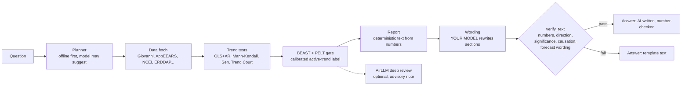

# Trend harness: our pipeline, your local model

The harness packages the Earth System Trend Detective pipeline so anyone can install it, connect their own
local model, and run it. It is a thin layer (`backend/harness/`) over the existing code: it adds a config
file, a model probe, a CLI and two API endpoints. It does not duplicate or change the science.

**Honest summary.** The pipeline is not built around AirLLM. The live model (default `qwen3.5:4b` in Ollama)
plans questions and rewrites report wording. AirLLM is an optional, slow, advisory deep reviewer. Every
number, test and verdict comes from the deterministic engine, so a different model changes the wording,
not the results.

## Architecture



| Stage | Component | What the model may do |
|---|---|---|
| Plan | `backend/ai/assistant.py`, `guard.py` | suggest variable / place / period when the offline planner cannot; the catalog and guard decide |
| Data | `backend/timeseries/` | nothing |
| Trend tests | `backend/analysis/` | nothing |
| BEAST + PELT gate | `backend/active/` | nothing |
| Report | `backend/report/builder.py` | nothing |
| Wording | local model, `pipeline.rewrite_sections` | rewrite wording from a FACTS object |
| Number check | `backend/ai/verify.py` + honest-wording guard | nothing; rejected text falls back to the template |
| Deep review | AirLLM (`backend/ai/deep_llm.py`) | advisory note only, never changes a verdict |

`GET /api/harness` returns this table, the active config (secrets removed), model status and prompt names.

## Install

```bash
git clone <this repository> && cd NASA
pip install -e .                 # installs the backend and the `trend-harness` command
```

Use an editable install (`-e`): the catalog and cache live in the repository's `data/` folder.
Docker: `docker build -t trend-detective . && docker run -p 8000:8000 -e LLM_BASE_URL=http://host.docker.internal:11434 trend-detective`
(the model runs on the host).

## Connect your model

```bash
trend-harness init               # writes harness.toml; detects Ollama (11434), LM Studio (1234), llama.cpp (8080)
```

| Runtime | `[model]` settings |
|---|---|
| Ollama | `provider = "ollama"`, `base_url = "http://127.0.0.1:11434"`, `name = "qwen3.5:4b"` |
| LM Studio | `provider = "openai-compatible"`, `base_url = "http://127.0.0.1:1234"` |
| llama.cpp server | `provider = "openai-compatible"`, `base_url = "http://127.0.0.1:8080"` |
| vLLM | `provider = "openai-compatible"`, `base_url = "http://127.0.0.1:8000"` (run the API on another port) |
| AirLLM | `[deep] provider = "airllm"` after `pip install -r requirements-airllm.txt` (see `scripts/airllm_setup.py`) |
| none | `provider = "none"`: template text only, same numbers |

`[model] provider = "airllm"` is accepted but becomes the deep tier: AirLLM costs seconds per token and is
too slow for live wording.

Other keys: `[pipeline] alpha` (0 < alpha <= 0.1), `min_years` (15 or more; the BEAST + PELT gate was
calibrated at 15), `verify = "strict"` (cannot be loosened), `rewrite`, `rewrite_sections`.
`[data.credentials]` maps each credential to an environment variable **name**; a value that looks like a
secret is rejected. Unknown keys are errors.

## Run

```bash
trend-harness doctor                                   # config, model probe, credentials, BEAST
trend-harness ask "temperature in India from 2002 to 2022"
trend-harness ask "rainfall in Chennai since 2001" --json
trend-harness serve --port 8000                        # API + harness config; web app uses /api
```

`python -m backend.harness ...` works the same. `--config path` or `TREND_HARNESS_CONFIG` picks another file.
A server started with plain `uvicorn backend.main:app` uses `.env`; `GET /api/harness` says which.

### The model gate (`doctor`, `POST /api/harness/probe`)

The probe gives the model a small FACTS object (a rising trend of 0.27 °C per decade, 1995-2024, p = 0.003),
asks for two sentences, and runs `verify_text` on the answer. It reports pass / fail, latency and an
approximate tokens/s (estimated from text length). A model that answers but invents a number fails.
Example on a laptop with a 4 GB GPU: `qwen3.5:4b` passed 5/5 checks in about 4 s.

## How accuracy is protected

1. **Numbers only from the engine.** The model receives computed facts and returns text; it never computes.
2. **`verify_text`** traces every number and year to the facts, and checks direction, significance claims,
   causal wording ("caused by" is rejected; "consistent with" is allowed) and forecast wording.
3. **Honest-wording guard** (`report/builder.py`): forbidden phrases are rejected and caveats such as
   NOT PROVEN, "exploratory" and "not a forecast" must survive a rewrite.
4. **BEAST + PELT calibrated gate**: the VERIFIED / PROBABLE / NOT VERIFIED label comes from independent
   statistical checks, never from a model.
5. **Fallback**: any failed check keeps the deterministic template text. Nothing half-checked is shown.

## What "higher accuracy" honestly means

A bigger or better local model gives clearer wording, more sections passing the number check, and better
planning of unusual questions. It does **not** change slopes, p-values, change dates or verdicts: those are
identical with any model, or with none. AI review is advisory; the model never decides a verdict.

## Limits

- Speed figures from the probe are estimates from one short answer.
- The harness config is applied per process by `serve` / `ask`; it sets process-wide knobs
  (`MIN_YEARS`, the rewrite section list).
- NASA Giovanni / AppEEARS data still need Earthdata credentials; keyless sources (NOAA ERDDAP etc.) work without.
